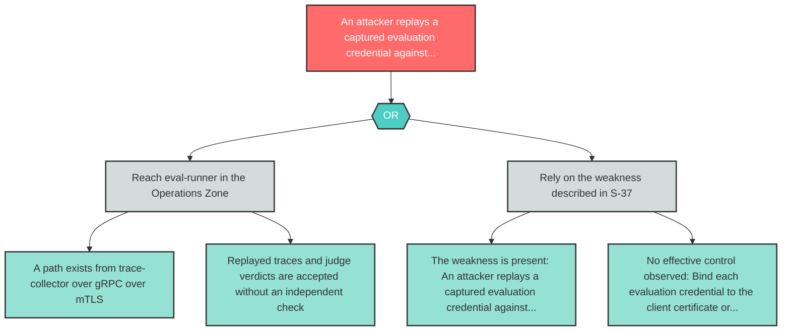

# S-37: An attacker replays a captured evaluation credential against...

**Component**: eval-runner | **Risk Level**: High | **Finding**: S-37

An attacker replays a captured evaluation credential against eval-runner, which does not bind the credential to the session or channel it was issued for, so the replay is accepted as the original caller.

