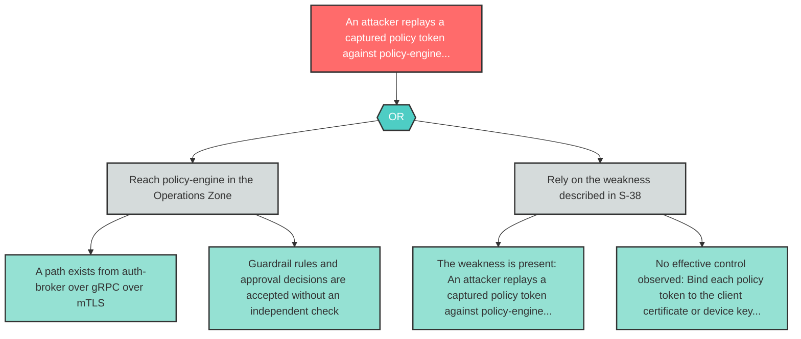

# S-38: An attacker replays a captured policy token against policy-engine...

**Component**: policy-engine | **Risk Level**: High | **Finding**: S-38

An attacker replays a captured policy token against policy-engine, which does not bind the credential to the session or channel it was issued for, so the replay is accepted as the original caller.

