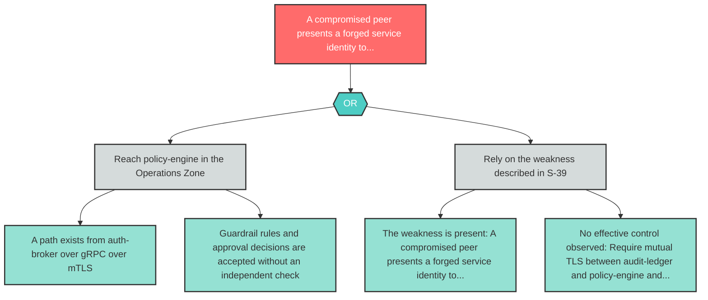

# S-39: A compromised peer presents a forged service identity to...

**Component**: policy-engine | **Risk Level**: Critical | **Finding**: S-39

A compromised peer presents a forged service identity to policy-engine, and policy-engine accepts the claim without verifying the signature chain back to the issuing authority.

