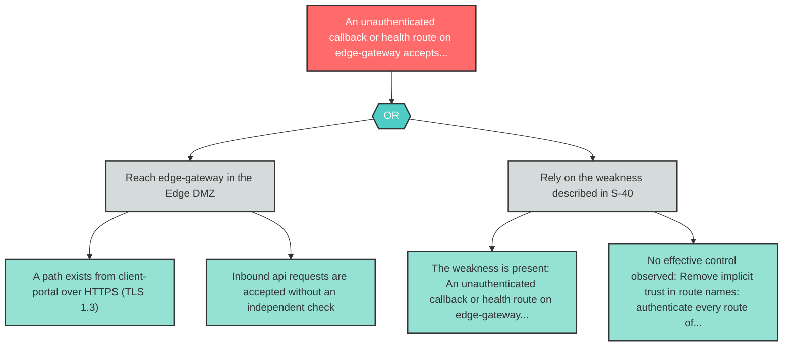

# S-40: An unauthenticated callback or health route on edge-gateway...

**Component**: edge-gateway | **Risk Level**: High | **Finding**: S-40

An unauthenticated callback or health route on edge-gateway accepts requests that downstream code treats as if they had come from auth-broker.

