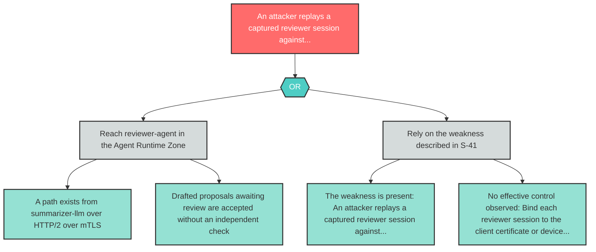

# S-41: An attacker replays a captured reviewer session against...

**Component**: reviewer-agent | **Risk Level**: High | **Finding**: S-41

An attacker replays a captured reviewer session against reviewer-agent, which does not bind the credential to the session or channel it was issued for, so the replay is accepted as the original caller.

