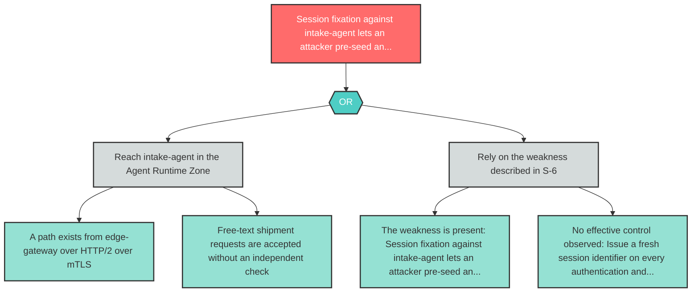

# S-6: Session fixation against intake-agent lets an attacker pre-seed an...

**Component**: intake-agent | **Risk Level**: High | **Finding**: S-6

Session fixation against intake-agent lets an attacker pre-seed an identifier and reuse the session after the victim authenticates.

