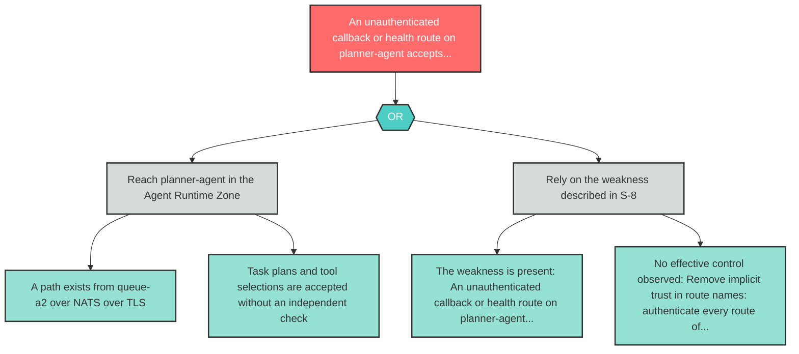

# S-8: An unauthenticated callback or health route on planner-agent...

**Component**: planner-agent | **Risk Level**: Critical | **Finding**: S-8

An unauthenticated callback or health route on planner-agent accepts requests that downstream code treats as if they had come from trace-collector.

