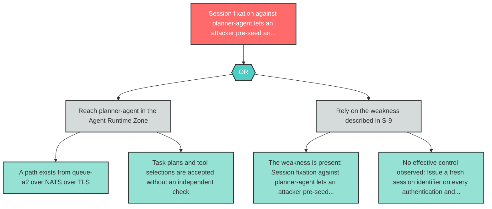

# S-9: Session fixation against planner-agent lets an attacker pre-seed...

**Component**: planner-agent | **Risk Level**: High | **Finding**: S-9

Session fixation against planner-agent lets an attacker pre-seed an identifier and reuse the session after the victim authenticates.

