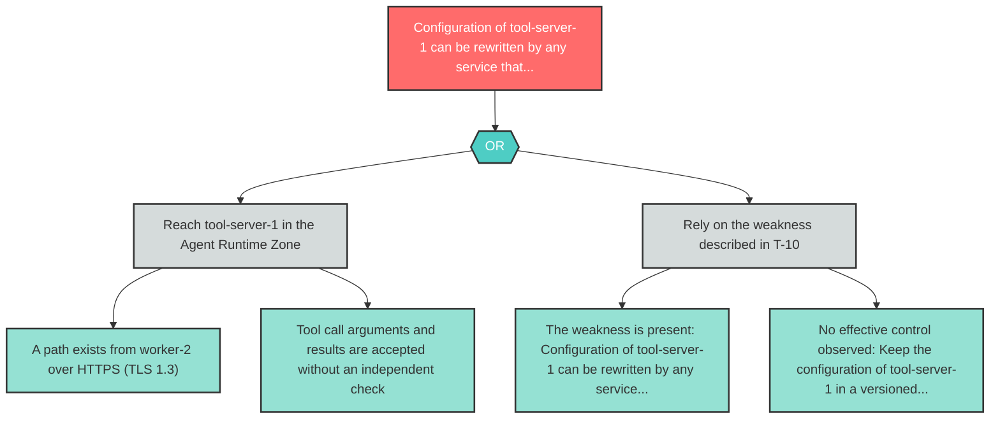

# T-10: Configuration of tool-server-1 can be rewritten by any service...

**Component**: tool-server-1 | **Risk Level**: Critical | **Finding**: T-10

Configuration of tool-server-1 can be rewritten by any service that holds the shared deployment credential, silently changing how tool call arguments and results are handled.

