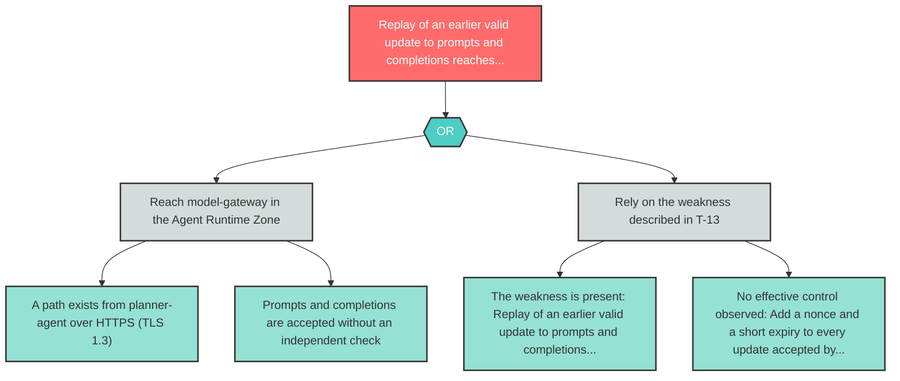

# T-13: Replay of an earlier valid update to prompts and completions...

**Component**: model-gateway | **Risk Level**: High | **Finding**: T-13

Replay of an earlier valid update to prompts and completions reaches model-gateway because updates carry no nonce or expiry, restoring a state the owner already corrected.

