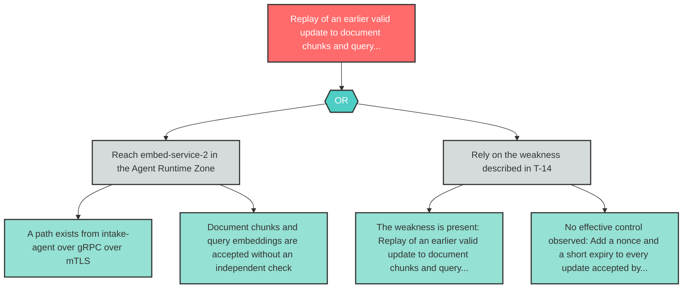

# T-14: Replay of an earlier valid update to document chunks and query...

**Component**: embed-service-2 | **Risk Level**: High | **Finding**: T-14

Replay of an earlier valid update to document chunks and query embeddings reaches embed-service-2 because updates carry no nonce or expiry, restoring a state the owner already corrected.

