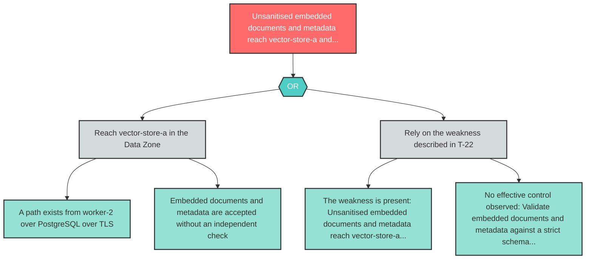

# T-22: Unsanitised embedded documents and metadata reach vector-store-a...

**Component**: vector-store-a | **Risk Level**: High | **Finding**: T-22

Unsanitised embedded documents and metadata reach vector-store-a and are processed as trusted structure, so crafted input changes how later steps interpret the record.

