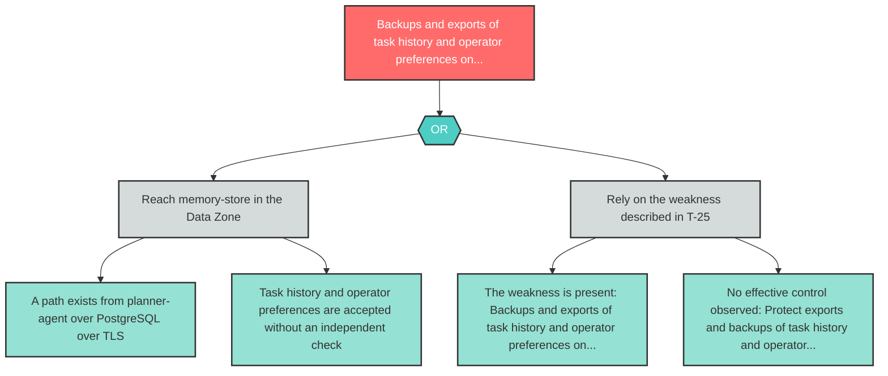

# T-25: Backups and exports of task history and operator preferences on...

**Component**: memory-store | **Risk Level**: Critical | **Finding**: T-25

Backups and exports of task history and operator preferences on memory-store are writable by operators without a second approver, so a malicious change survives restores.

