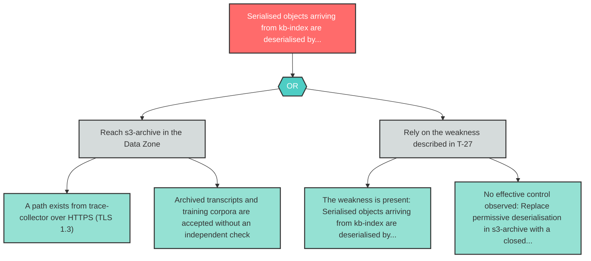

# T-27: Serialised objects arriving from kb-index are deserialised by...

**Component**: s3-archive | **Risk Level**: Critical | **Finding**: T-27

Serialised objects arriving from kb-index are deserialised by s3-archive with permissive type handling, allowing crafted payloads to instantiate unintended behaviour.

