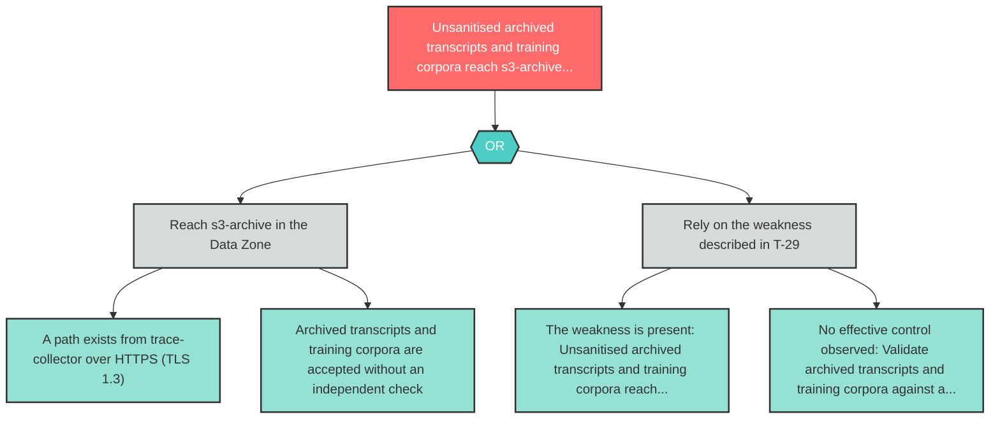

# T-29: Unsanitised archived transcripts and training corpora reach...

**Component**: s3-archive | **Risk Level**: High | **Finding**: T-29

Unsanitised archived transcripts and training corpora reach s3-archive and are processed as trusted structure, so crafted input changes how later steps interpret the record.

