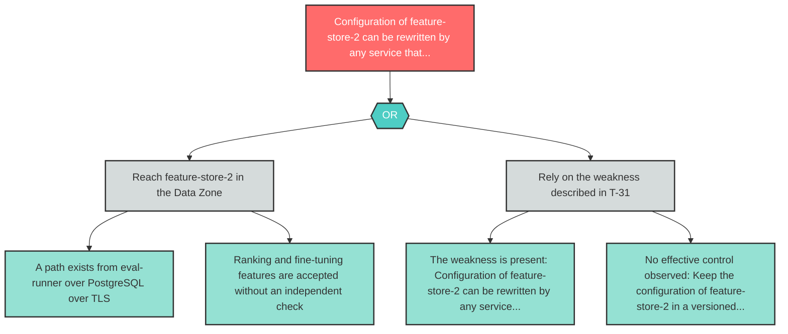

# T-31: Configuration of feature-store-2 can be rewritten by any service...

**Component**: feature-store-2 | **Risk Level**: High | **Finding**: T-31

Configuration of feature-store-2 can be rewritten by any service that holds the shared deployment credential, silently changing how ranking and fine-tuning features are handled.

