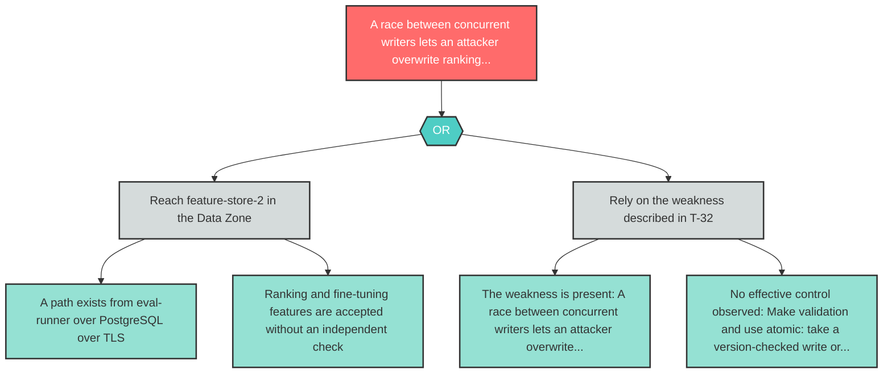

# T-32: A race between concurrent writers lets an attacker overwrite...

**Component**: feature-store-2 | **Risk Level**: High | **Finding**: T-32

A race between concurrent writers lets an attacker overwrite ranking and fine-tuning features on feature-store-2 after validation but before use, defeating the earlier check.

