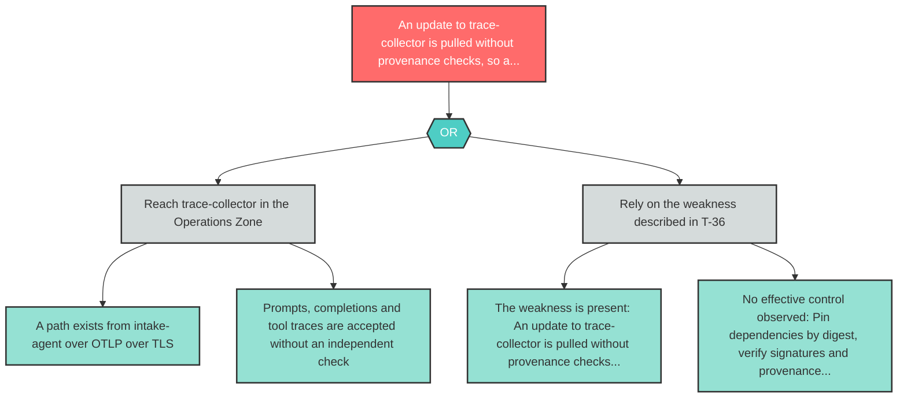

# T-36: An update to trace-collector is pulled without provenance checks...

**Component**: trace-collector | **Risk Level**: High | **Finding**: T-36

An update to trace-collector is pulled without provenance checks, so a poisoned package can alter how prompts, completions and tool traces are handled at run time.

