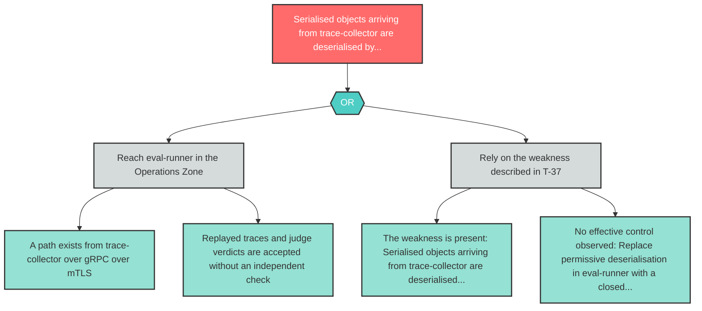

# T-37: Serialised objects arriving from trace-collector are deserialised...

**Component**: eval-runner | **Risk Level**: Critical | **Finding**: T-37

Serialised objects arriving from trace-collector are deserialised by eval-runner with permissive type handling, allowing crafted payloads to instantiate unintended behaviour.

