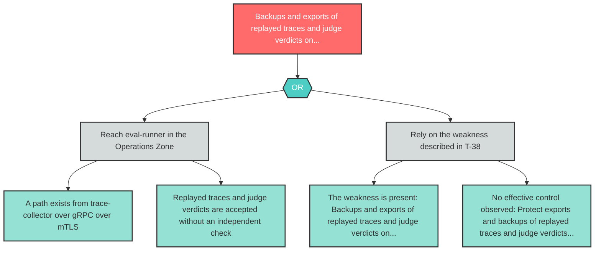

# T-38: Backups and exports of replayed traces and judge verdicts on...

**Component**: eval-runner | **Risk Level**: High | **Finding**: T-38

Backups and exports of replayed traces and judge verdicts on eval-runner are writable by operators without a second approver, so a malicious change survives restores.

