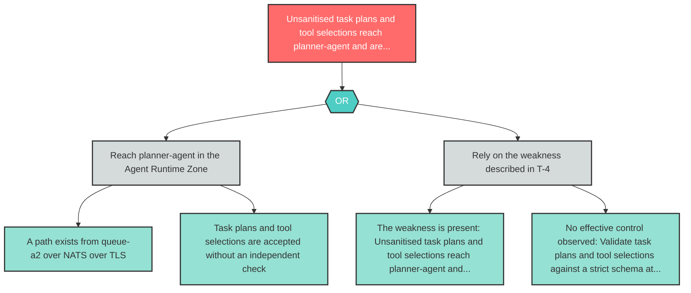

# T-4: Unsanitised task plans and tool selections reach planner-agent and...

**Component**: planner-agent | **Risk Level**: High | **Finding**: T-4

Unsanitised task plans and tool selections reach planner-agent and are processed as trusted structure, so crafted input changes how later steps interpret the record.

