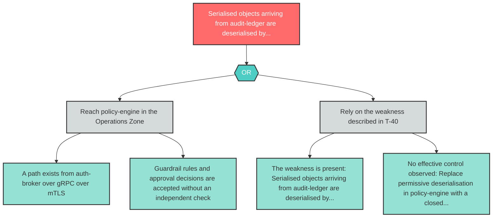

# T-40: Serialised objects arriving from audit-ledger are deserialised by...

**Component**: policy-engine | **Risk Level**: High | **Finding**: T-40

Serialised objects arriving from audit-ledger are deserialised by policy-engine with permissive type handling, allowing crafted payloads to instantiate unintended behaviour.

