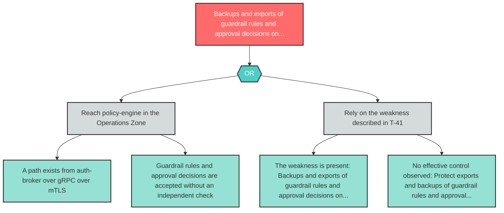

# T-41: Backups and exports of guardrail rules and approval decisions on...

**Component**: policy-engine | **Risk Level**: High | **Finding**: T-41

Backups and exports of guardrail rules and approval decisions on policy-engine are writable by operators without a second approver, so a malicious change survives restores.

