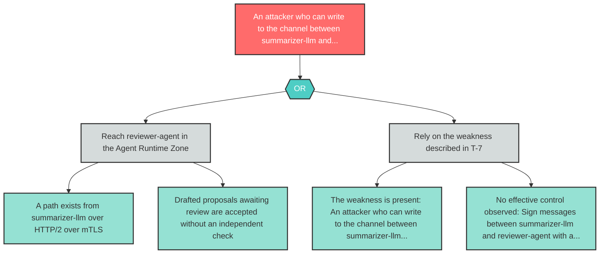

# T-7: An attacker who can write to the channel between summarizer-llm...

**Component**: reviewer-agent | **Risk Level**: High | **Finding**: T-7

An attacker who can write to the channel between summarizer-llm and reviewer-agent modifies drafted proposals awaiting review in transit because messages carry no integrity protection of their own.

