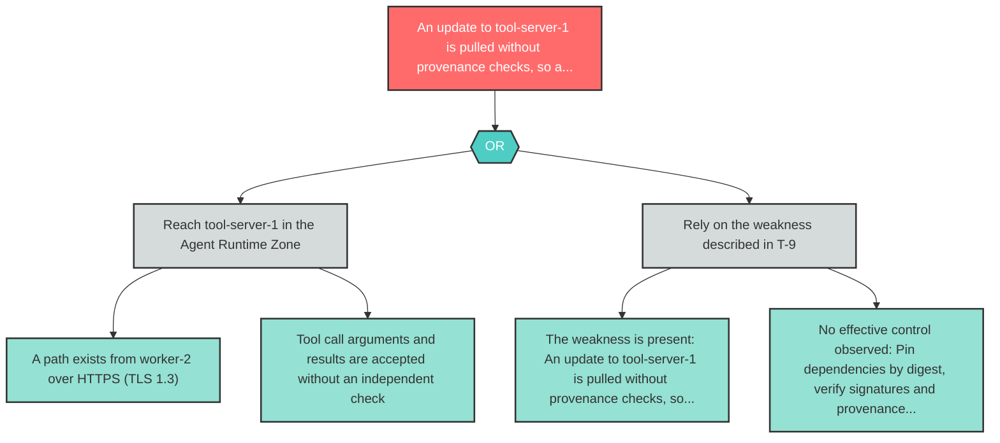

# T-9: An update to tool-server-1 is pulled without provenance checks, so...

**Component**: tool-server-1 | **Risk Level**: High | **Finding**: T-9

An update to tool-server-1 is pulled without provenance checks, so a poisoned package can alter how tool call arguments and results are handled at run time.

