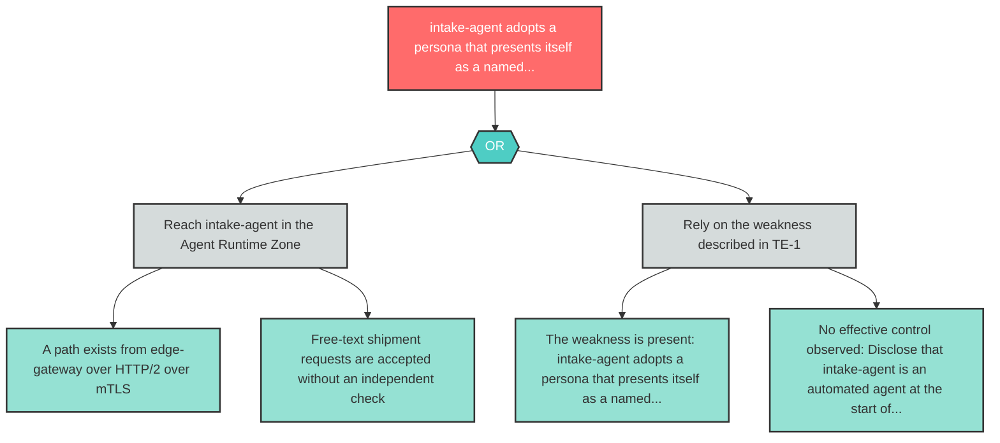

# TE-1: intake-agent adopts a persona that presents itself as a named...

**Component**: intake-agent | **Risk Level**: High | **Finding**: TE-1

intake-agent adopts a persona that presents itself as a named colleague, so operators trust its suggestions more than its accuracy warrants.

