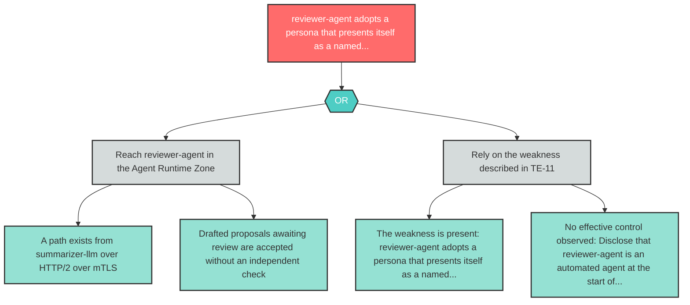

# TE-11: reviewer-agent adopts a persona that presents itself as a named...

**Component**: reviewer-agent | **Risk Level**: Critical | **Finding**: TE-11

reviewer-agent adopts a persona that presents itself as a named colleague, so operators trust its suggestions more than its accuracy warrants.

