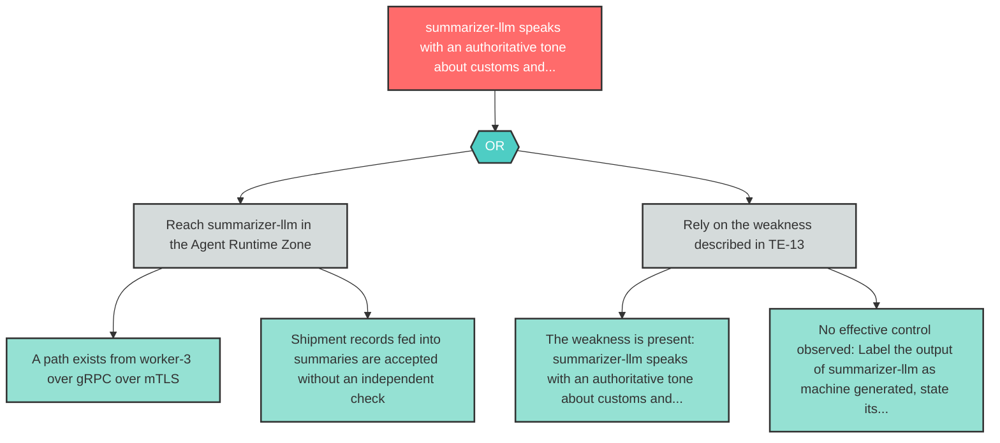

# TE-13: summarizer-llm speaks with an authoritative tone about customs and...

**Component**: summarizer-llm | **Risk Level**: High | **Finding**: TE-13

summarizer-llm speaks with an authoritative tone about customs and legal matters, and operators may defer to it without checking.

