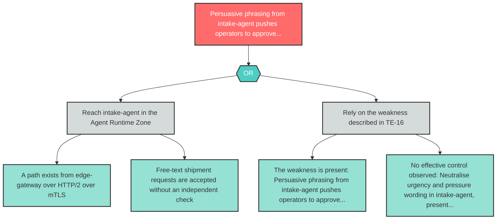

# TE-16: Persuasive phrasing from intake-agent pushes operators to approve...

**Component**: intake-agent | **Risk Level**: High | **Finding**: TE-16

Persuasive phrasing from intake-agent pushes operators to approve proposals quickly, which reduces careful review.

