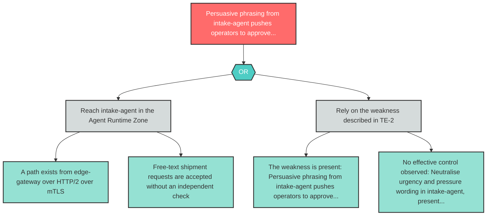

# TE-2: Persuasive phrasing from intake-agent pushes operators to approve...

**Component**: intake-agent | **Risk Level**: Critical | **Finding**: TE-2

Persuasive phrasing from intake-agent pushes operators to approve proposals quickly, which reduces careful review.

