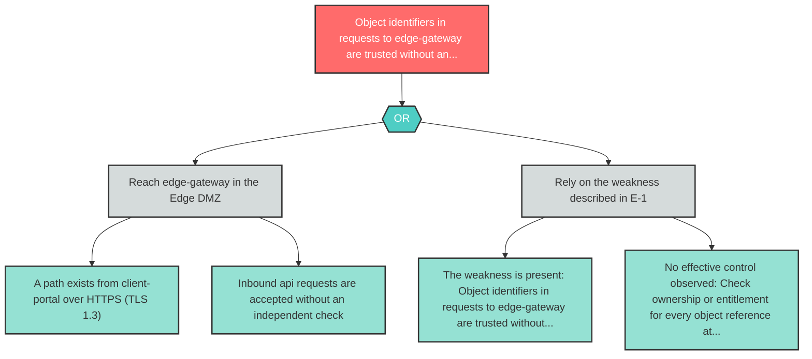

# E-1: Object identifiers in requests to edge-gateway are trusted without...

Carried from the baseline run.

**Component**: edge-gateway | **Risk Level**: High | **Finding**: E-1

Object identifiers in requests to edge-gateway are trusted without an ownership check, so a caller can read or change inbound API requests that belong to others.

