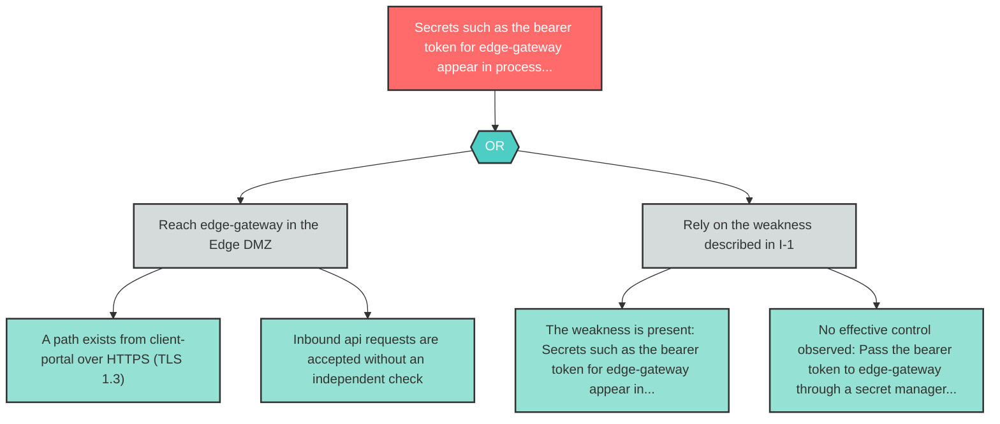

# I-1: Secrets such as the bearer token for edge-gateway appear in...

Carried from the baseline run.

**Component**: edge-gateway | **Risk Level**: High | **Finding**: I-1

Secrets such as the bearer token for edge-gateway appear in process arguments and environment dumps that diagnostic tooling captures.

