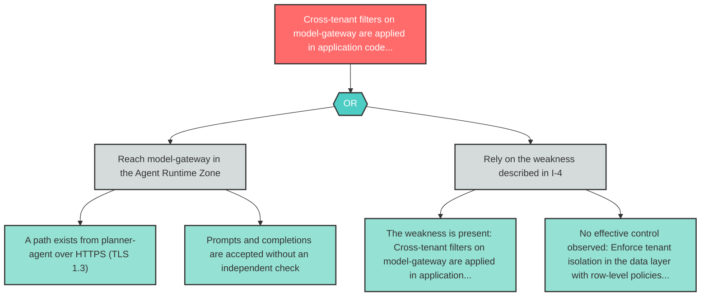

# I-4: Cross-tenant filters on model-gateway are applied in application...

Carried from the baseline run.

**Component**: model-gateway | **Risk Level**: High | **Finding**: I-4

Cross-tenant filters on model-gateway are applied in application code only, so one missing predicate exposes another tenant's prompts and completions.

