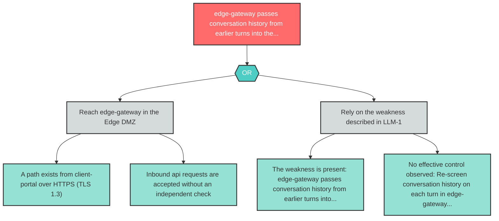

# LLM-1: edge-gateway passes conversation history from earlier turns into...

Carried from the baseline run.

**Component**: edge-gateway | **Risk Level**: Critical | **Finding**: LLM-1

edge-gateway passes conversation history from earlier turns into the model unchanged, so an injection planted earlier keeps working in later turns.

