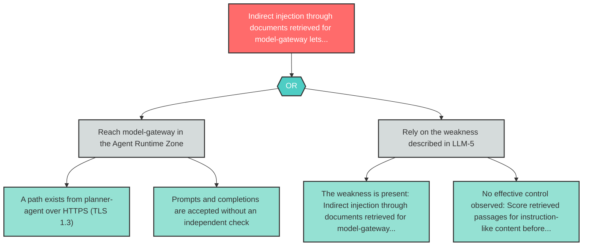

# LLM-5: Indirect injection through documents retrieved for model-gateway...

Carried from the baseline run.

**Component**: model-gateway | **Risk Level**: High | **Finding**: LLM-5

Indirect injection through documents retrieved for model-gateway lets the author of a retrieved page steer the answer without ever talking to the system.

