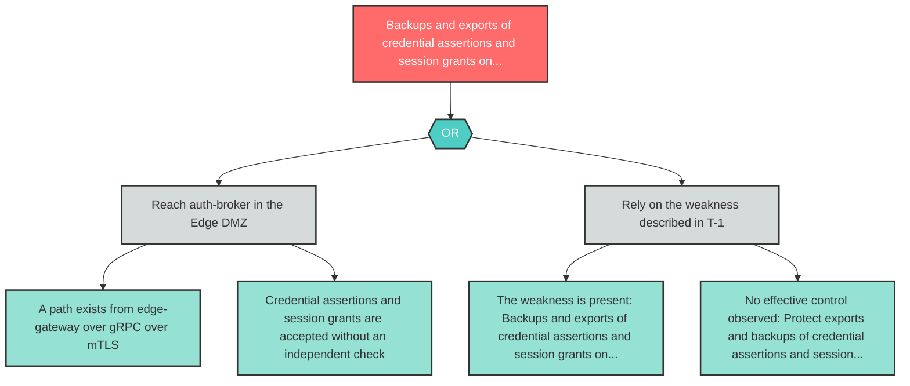

# T-1: Backups and exports of credential assertions and session grants on...

Carried from the baseline run.

**Component**: auth-broker | **Risk Level**: High | **Finding**: T-1

Backups and exports of credential assertions and session grants on auth-broker are writable by operators without a second approver, so a malicious change survives restores.

