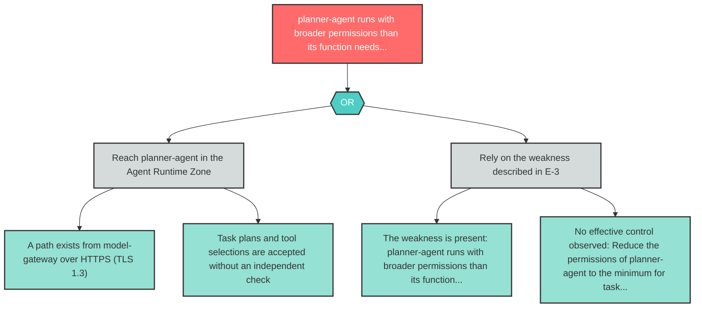

# E-3: planner-agent runs with broader permissions than its function...

**Component**: planner-agent | **Risk Level**: High | **Finding**: E-3

planner-agent runs with broader permissions than its function needs, so a flaw in handling task plans and tool selections yields access to unrelated resources.

