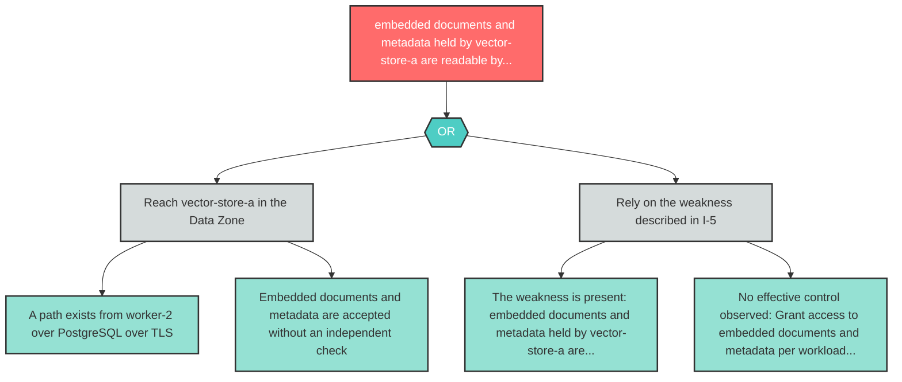

# I-5: embedded documents and metadata held by vector-store-a are...

**Component**: vector-store-a | **Risk Level**: Critical | **Finding**: I-5

embedded documents and metadata held by vector-store-a are readable by any service in the Data Zone that shares the same network role, because access is granted by network position.

