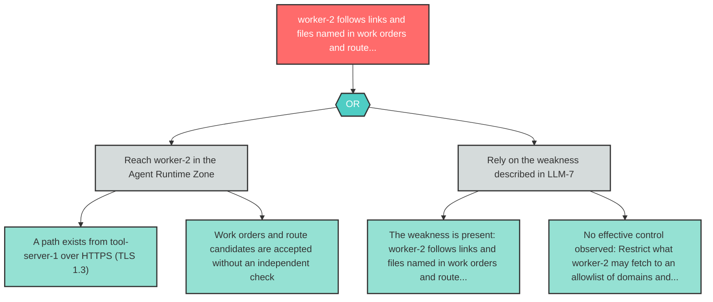

# LLM-7: worker-2 follows links and files named in work orders and route...

**Component**: worker-2 | **Risk Level**: Critical | **Finding**: LLM-7

worker-2 follows links and files named in work orders and route candidates, which turns a harmless-looking request into a fetch of attacker-controlled content.

