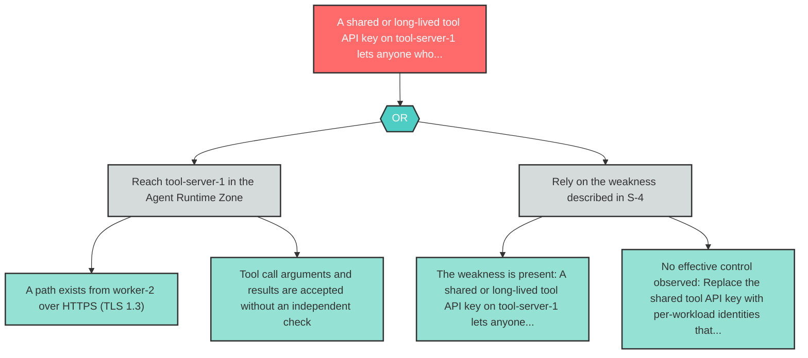

# S-4: A shared or long-lived tool API key on tool-server-1 lets anyone...

**Component**: tool-server-1 | **Risk Level**: High | **Finding**: S-4

A shared or long-lived tool API key on tool-server-1 lets anyone who obtains one copy authenticate as every tenant that uses the same deployment profile.

