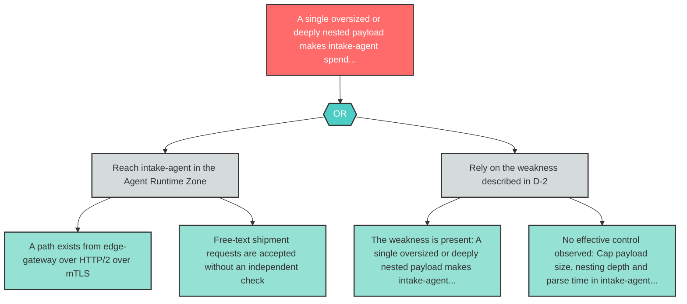

# D-2: A single oversized or deeply nested payload makes intake-agent...

**Component**: intake-agent | **Risk Level**: High | **Finding**: D-2

A single oversized or deeply nested payload makes intake-agent spend disproportionate memory and CPU parsing free-text shipment requests.

