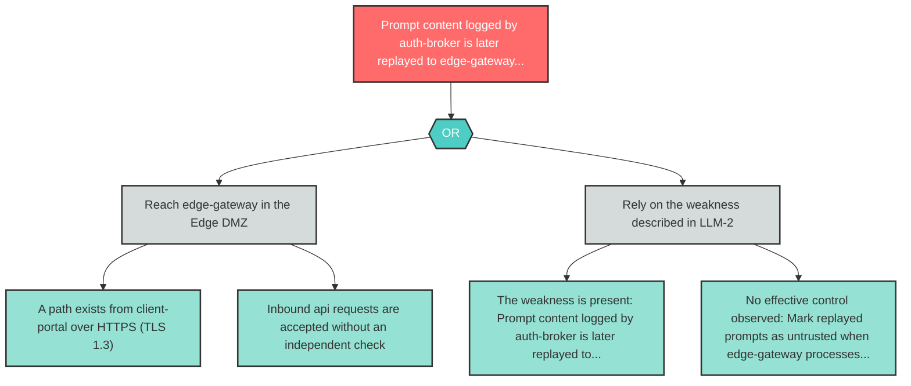

# LLM-2: Prompt content logged by auth-broker is later replayed to...

**Component**: edge-gateway | **Risk Level**: High | **Finding**: LLM-2

Prompt content logged by auth-broker is later replayed to edge-gateway for evaluation, carrying planted instructions into a trusted context.

